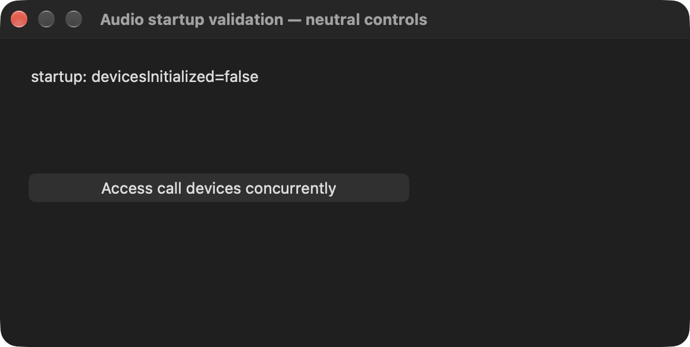
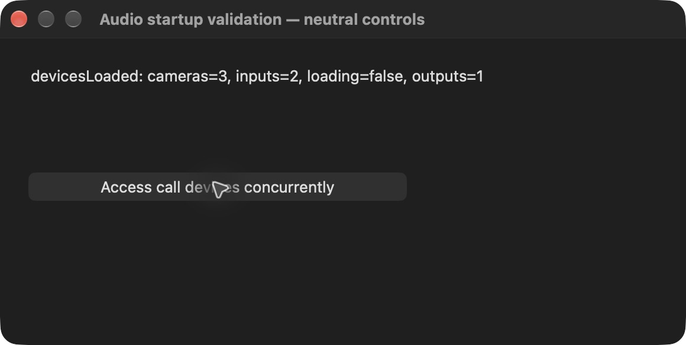

# Deferred call-device discovery — November 4 native verification

Production feature cce8e5ae, based on upstream 561169337e83. Local full-client integration cecd91f5 uses real dependencies and isolated SDK/profile/keychain overrides. macOS 27.0.1 (26A434), Xcode 27.2 (27B52), Telegram 13.1.0 (283357), Debug arm64. Both the diagnostic and final full builds succeeded. No diagnostic substitutions remain in the shipping sources.

## Before and after

There is no shipping UI change. observations.json summarizes real CoreAudio process observations around app startup. Before the patch, the test client registered with CoreAudio without a call; after the patch, no client registration appeared during the 60-second startup observation. It appeared after explicit call-device access. No Telegram input or output IO was observed in either startup case or the demand check. Device IDs, process IDs, names and private account/chat data are omitted from the published summary; raw observations remain local.

The temporary native controls read the actual production cache, then concurrently invoke its actual getter. At startup it is empty. Two sets of 64 concurrent reads each return exactly one instance. Device discovery then emits a non-loading camera/input/output list. The helper does not start microphone/camera capture or a call. native-events.json contains the observed data.

These neutral windows are diagnostic controls, not a changed product UI:

## Reproduce

Use your separately configured isolated Debug checkout/profile, not your primary account. The scene does not set up isolation for you.

- For the passive CoreAudio observer: `xcrun swiftc AudioProbe.swift -o AudioProbe`, then `./AudioProbe observations.json 60`. Launch the client while it runs. It reads CoreAudio process/default-output metadata and records no audio. It watches Telegram’s public bundle ID and local.codex.Telegram test bundle IDs. Run against unpatched upstream 561169337e83 and patched feature cce8e5ae with the same isolated profile.
- On the patched checkout only, build the native controls with `python3 run-native.py --source-root /path/to/telegram-macos -- YOUR_NORMAL_BUILD_COMMAND`. Launch your isolated build with TELEGRAM_VALIDATION_ROOT set. Select “Audio startup validation — neutral controls” from Window; startup should report false. Press Access call devices concurrently twice. JSON is written to the process temporary directory as AudioStartup-native-events.json. The script restores both temporarily substituted files on success or failure.
- Run `python3 camera-fallback.py /path/to/patched/telegram-macos` to compile the exact production camera-selection expressions with controlled capture/device collaborators. The unpatched expression passes 4/5 cases, the new expression 5/5: a valid saved selection is retained before the asynchronous cache is ready, an unavailable selection falls back, and an already resolved device takes precedence. This is not live video-call evidence.

## Limits

The observed output transport was built-in and the sample rate stayed 96000. The reported headphone pause was not captured by the automated observer. After testing the final patched Telegram Message Fixes build by relaunching it during the same music on the Mac with headphones, the user reported no pause. This is user hardware verification, distinct from the instrumented built-in-output run. No live call or recording was tested. The demonstrated change is elimination of unnecessary startup device discovery/CoreAudio registration with working first-demand discovery and camera-selection fallback. Native screenshots contain only generic controls and no personal chats.

Evidence stays outside the production PR.
