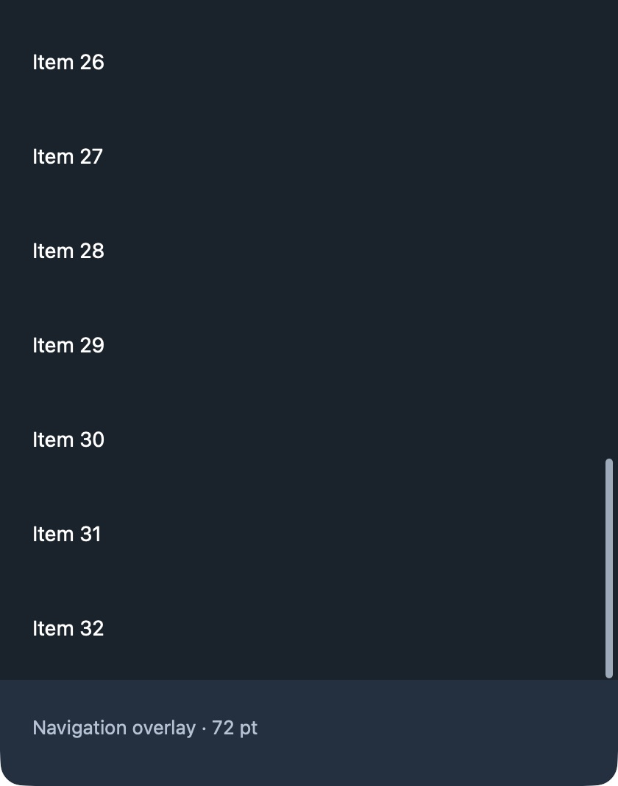
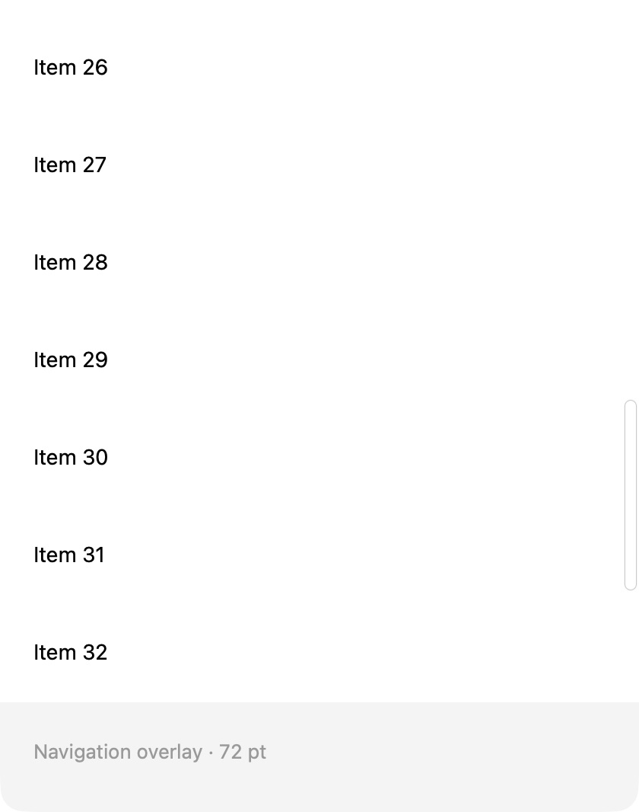
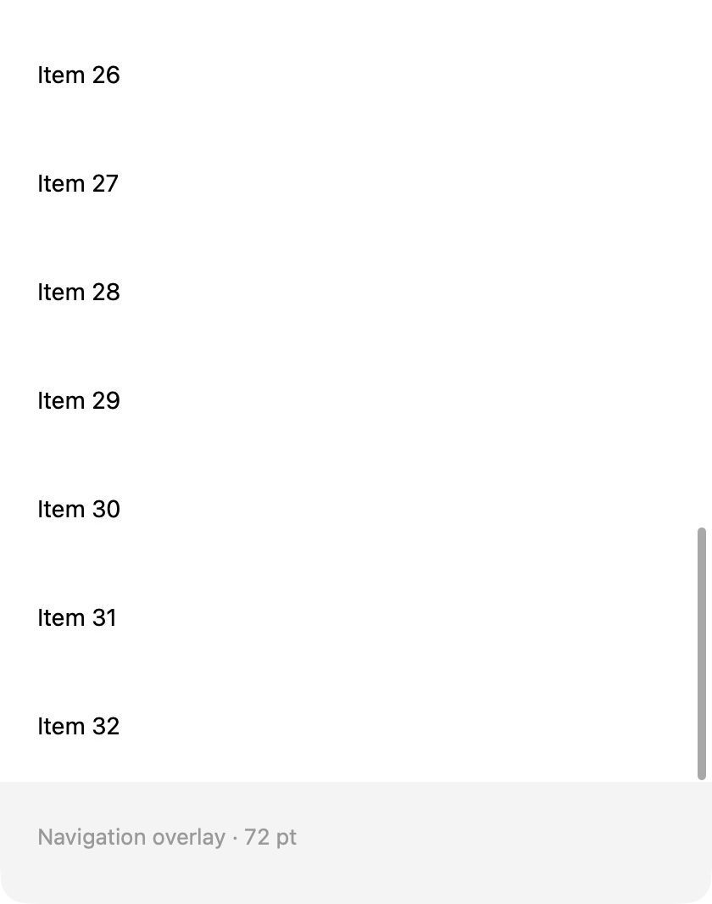

# Sidebar scrollbar regression

The main chat list and sidebar search used the same footer height in both `contentInsets.bottom` and `scrollerInsets.bottom`. AppKit adds these insets when tiling its overlay scroller. The track therefore stopped one extra footer height above the bottom of the usable list, even at native scroll progress 1.

The fix retains the content inset for the floating navigation bar, removes its duplicate from the scroller, and preserves the separate top inset for chat-list header rows. `SidebarTableView` installs a native overlay `NSScroller` subclass only in these sidebar tables. It paints a rounded 3 pt thumb (5 pt while expanded/tracking or with increased contrast), using the current palette's `grayText`. Native hit geometry, dragging and auto-hide remain AppKit's responsibility.

## Run

```sh
python3 tools/tests/sidebar-scroll/run.py --scratch-path /tmp/telegram-sidebar-scroll
```

Dependencies must be initialized. An existing full checkout can supply dependencies with `--dependency-root /path/to/telegram-macos`. Reuse the scratch path for both runs.

```sh
python3 tools/tests/sidebar-scroll/run.py --revision e537320b28d79cecc1baf716bcbf822b02f93b7a --scratch-path /tmp/telegram-sidebar-scroll
```

The baseline intentionally exits nonzero: 216 checks, 12 failures for the duplicated bottom inset. The candidate passes all 216 checks. Tests compile the production `SidebarTableView` unchanged and extract the inset assignments from the two real controllers; controlled rows avoid a network/account dependency. They cover both sidebar paths, short/long lists, 400/800 pt heights, 0/56/80 pt footer insets, chat header insets, native top/middle/bottom progress, knob endpoints and native hit testing. AppKit's 1 pt knob end padding is retained.

## Native visual comparison

Add `--prepare-app` to build `SidebarScrollValidation.app` inside the scratch path, then open that app. Quit the running copy before building the other revision. Buttons select the top/bottom endpoint and dark/light palettes.

The images below are native captures of the production TableView/NSScroller with controlled numbered rows and a 72 pt footer overlay, **not screenshots of an authenticated Telegram screen**. Both revisions are scrolled to native progress 1, with identical 420×680 pt window geometry. The captures are cropped to the rows and footer; no pixels inside the crop are altered.

| Palette | Before | After |
| --- | --- | --- |
| Dark |  |  |
| Light |  |  |

On macOS 27.0.1 (26A434), the native fixture also verified a mouse drag from the bottom to the top (native value 1 → 0), theme changes, and the top endpoint. See [regression output](evidence/regression.txt).

## Full client validation

Telegram Message Fixes 13.1.0 (283357), Debug arm64, integration `7e93777e036872a312e59faec8f27733fc65843c`, macOS 27.0.1 (26A434). The complete workspace build succeeded, and the isolated signed client launched with its existing authenticated account. In the actual client, the chat list was scrolled to both endpoints; sidebar search was opened and a scrollable query was taken to its lower endpoint. The thumb styling and footer boundary were inspected in the client as well. Private account captures remain local; the published matching comparison uses controlled native rows.

[Build record](evidence/native-build.txt). Only this macOS version and a Debug integration build were available; other OS versions, a distribution build and the macOS increased-contrast preference were not exercised.
